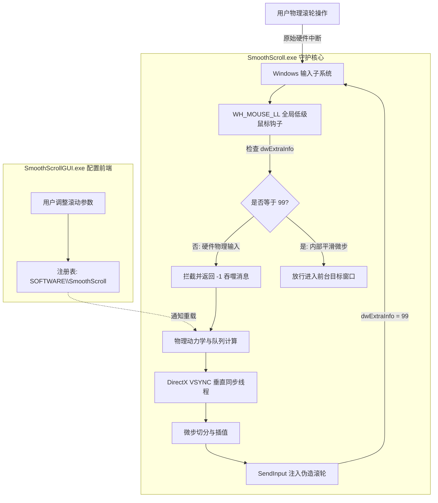
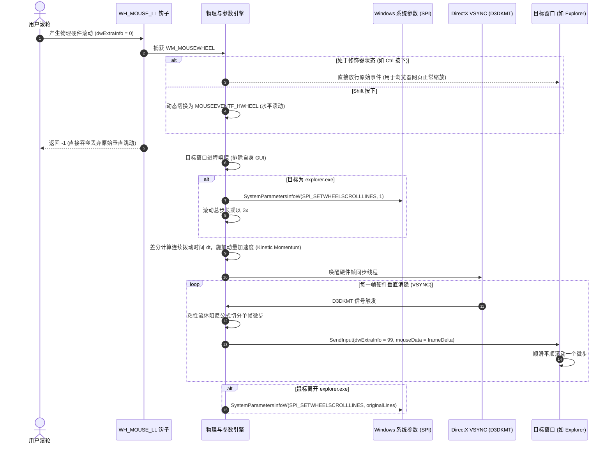

# SmoothScroll 核心原理与底层逆向分析报告（深度解密版）

> **目标版本**：SmoothScroll for Windows `1.2.4.0`  
> **开发者**：Balázs Galambosi  
> **逆向工具链**：REA MCP + Ghidra 12.1.4 (x86_64) + REA .NET CLI Analyzer  
> **分析时间**：2026-11-08  

---

## 目录
1. [系统整体架构与分工](#一系统整体架构与分工)
2. [鼠标滚轮劫持与防重入机制（WH_MOUSE_LL）](#二鼠标滚轮劫持与防重入机制wh_mouse_ll)
3. [资源管理器（Explorer）专属破解技巧](#三资源管理器explorer专属破解技巧)
4. [DirectX 硬件级垂直同步（VSYNC）对齐](#四directx-硬件级垂直同步vsync对齐)
5. [物理衰减与缓动曲线数学模型](#五物理衰减与缓动曲线数学模型)
6. [微步插值与 SendInput 注入流水线](#六微步插值与-sendinput-注入流水线)
7. [进阶黑科技 1：修饰键智能避让与水平滚动转换](#七进阶黑科技-1修饰键智能避让与水平滚动转换)
8. [进阶黑科技 2：高精度滚轮/触控板的“防二次平滑”启发式](#八进阶黑科技-2高精度滚轮触控板的防二次平滑启发式)
9. [进阶黑科技 3：连续击发动态动量加速算法（Kinetic Momentum）](#九进阶黑科技-3连续击发动态动量加速算法kinetic-momentum)
10. [进阶黑科技 4：冲突应用检测与自身 UI 避让机制](#十进阶黑科技-4冲突应用检测与自身-ui-避让机制)
11. [全流程执行时序图](#十一全流程执行时序图)

---

## 一、系统整体架构与分工

SmoothScroll 安装目录采用“**C++ 底层高性能引擎 + .NET 易用性配置界面**”的经典混合分层架构：

| 组件名称 | 架构 / 语言 | 运行时 / 依赖 | 核心职责 |
| :--- | :--- | :--- | :--- |
| **`SmoothScroll.exe`** | PE32+ (x86_64 原生 C++) | `vcruntime140.dll`<br>`libexpat.dll` | 全局低级别鼠标钩子装载、消息拦截、物理动力学模拟、VSYNC 同步、合成输入注入。 |
| **`SmoothScrollGUI.exe`** | PE32 (.NET Framework 4.5 CIL) | AnyCPU CLR v4.0.30319 | 任务栏托盘图标、配置窗口（调节步长、动画时间、加速度、反弹力）、读写注册表 `HKCU\Software\SmoothScroll`。 |
| **`libexpat.dll`** | 64 位原生 C 库 | 无 | 负责解析选项配置文件（XML）及 WinSparkle 升级元数据（Appcast）。 |
| **`vcruntime140.dll`** | 64 位 MSVC 运行库 | Windows CRT | 提供 C++ 异常处理、内存对齐与基本 CRT 支持。 |



---

## 二、鼠标滚轮劫持与防重入机制（WH_MOUSE_LL）

### 1. 线程特权提升与钩子装载
在 `SmoothScroll.exe` 的主初始化函数 `0x14005d110` 中，程序首先对自身线程实施高优先级调度以保证零输入延迟：

```c
// 伪代码自 0x14005d110
hProcess = GetCurrentProcess();
hThread = GetCurrentThread();

// 提升至实时优先级类与最高线程调度级
SetPriorityClass(hProcess, REALTIME_PRIORITY_CLASS /* 0x100 */);
SetThreadPriority(hThread, THREAD_PRIORITY_TIME_CRITICAL /* 0xF */);

// 安装全局底层鼠标钩子 (idHook = 0xE 即 WH_MOUSE_LL)
g_hHook = SetWindowsHookExW(WH_MOUSE_LL /* 14 */, HookCallback_14005b780, NULL, 0);

// 标准消息泵
while (GetMessageW(&msg, NULL, 0, 0)) {
    if (msg.message == WM_CLOSE) break;
}

// 退出时优雅卸载
UnhookWindowsHookEx(g_hHook);
```

### 2. 钩子分流与魔法标记（Magic Token: 99）
低级别钩子（`WH_MOUSE_LL`）会拦截所有进入操作系统的鼠标消息。如果 SmoothScroll 注入的平滑微步再次被自身拦截，将导致致命的无限死循环。

SmoothScroll 使用了 `MSLLHOOKSTRUCT.dwExtraInfo` 作为标记通道：
* **拦截逻辑（`0x14005b780` & `0x14005bc60`）**：
  ```c
  LRESULT CALLBACK HookCallback_14005b780(int nCode, WPARAM wParam, LPARAM lParam) {
      if (nCode >= 0) {
          if (wParam == WM_MOUSEWHEEL /* 0x20A */) {
              MSLLHOOKSTRUCT* pMouse = (MSLLHOOKSTRUCT*)lParam;
              // 判断是否处理；若处理完成则直接返回 -1 (丢弃硬件滚动)
              if (ProcessWheelEvent_14005bc60(pMouse) == 0) {
                  return -1; // 阻止向操作系统后续链条与目标窗口传递！
              }
          }
      }
      return CallNextHookEx(NULL, nCode, wParam, lParam);
  }
  ```
* **防重入判断（`0x14005bc60`）**：
  ```c
  if (pMouse->dwExtraInfo == 99) {
      return false; // 放行！这是自身物理引擎拆分的微步，允许直接进入目标窗口！
  }
  ```

---

## 三、资源管理器（Explorer）专属破解技巧

### 1. 为什么文件资源管理器在常规算法下会失效？
* 普通窗口（如浏览器、现代编辑器）接收到较小的滚轮 delta（例如 `10`、`20`）时，能够按像素进行平滑移动。
* 但 Windows 文件资源管理器（`explorer.exe`）采用的是经典控件体系（`DirectUIHWND` / `SysListView32`），其内部只认离散行数（Lines）。
* Windows 默认设置下，鼠标滚一格等于跳跃 **3 行**（`SPI_GETWHEELSCROLLLINES = 3`）。如果第三方软件向其发送累加未满 120 的微步，资源管理器会将其缓存；而一旦累积满 120，就会猛然跳动 3 整行，造成极其糟糕的卡顿与跳帧。

### 2. 动态劫持系统参数（SPI_SETWHEELSCROLLLINES）
SmoothScroll 在 `FUN_14005bc60` 中展现了教科书般的精妙解法：

```c
// 1. 嗅探目标窗口是否属于 explorer.exe
GetWindowModuleFileNameW(hWndTarget, szPath, MAX_PATH);
if (wcsstr(szPath, L":\\Windows\\explorer.exe") != NULL) {
    // 2. 首次进入 explorer.exe: 将 Windows 全局滚轮行数强行修改为 1
    if (!g_bInExplorer) {
        // 保存用户原本设置后，写入 1 行
        SystemParametersInfoW(SPI_SETWHEELSCROLLLINES /* 0x69 */, 1, NULL, SPIF_SENDCHANGE /* 2 */);
        g_bInExplorer = true;
    }
    // 3. 将单次滚动总步长乘以 3 倍，以维持相同的物理位移总距离
    g_ScrollStepMultiplier = 3.0;
} else {
    // 4. 离开资源管理器或切换到普通窗口: 瞬间还原系统原始值
    if (g_bInExplorer) {
        SystemParametersInfoW(SPI_SETWHEELSCROLLLINES /* 0x69 */, g_OriginalScrollLines, NULL, 2);
        g_bInExplorer = false;
    }
}
```

> [!NOTE]
> **原理总结**：通过将系统滚轮行数从 3 降至 1，资源管理器每次响应滚动的最小量子单元缩小为原来的三分之一。配合 SmoothScroll 内部的垂直同步高频注入，连续发送单行指令，使得原本必须跳动 3 行的列表项呈现出流畅顺滑的滚动过渡。

---

## 四、DirectX 硬件级垂直同步（VSYNC）对齐

常规软件多使用 `SetTimer`、`timeSetEvent` 或简单的 `Sleep` 进行步进更新，容易因 Windows 调度抖动产生明显的微卡顿（Micro-stutter）与画面撕裂。

SmoothScroll 在专用动画工作线程 `0x14005cdd0` 中，直接调用了 Windows 显卡驱动内核接口（D3DKMT）：

```c
// 动态加载 gdi32.dll 的 D3D 内核接口
HMODULE hGdi = GetModuleHandleW(L"gdi32.dll");
pfnD3DKMTOpenAdapterFromHdc = GetProcAddress(hGdi, "D3DKMTOpenAdapterFromHdc");
pfnD3DKMTWaitForVerticalBlankEvent = GetProcAddress(hGdi, "D3DKMTWaitForVerticalBlankEvent");

// 绑定当前显示器 HDC 对应的适配器句柄
D3DKMT_OPENADAPTERFROMHDC openAdapter;
openAdapter.hDc = hdcDisplay;
pfnD3DKMTOpenAdapterFromHdc(&openAdapter);

// 开启 1ms 多媒体时钟保障
timeBeginPeriod(1);

// 核心帧同步死循环
while (!g_bStop) {
    D3DKMT_WAITFORVERTICALBLANKEVENT waitVBlank;
    waitVBlank.hAdapter = openAdapter.hAdapter;
    waitVBlank.hDevice = 0;
    waitVBlank.VidPnSourceId = openAdapter.VidPnSourceId;

    // 硬件阻塞：等待显示器完成一帧垂直消隐信号（VSYNC）！
    if (pfnD3DKMTWaitForVerticalBlankEvent(&waitVBlank) >= 0) {
        QueryPerformanceCounter(&qpcNow);
        Sleep(2); // 短暂让出微小时间片
        RenderScrollFrame_14005cb20(); // 精准在屏幕刷新瞬间驱动单帧物理位移！
    } else {
        // 显卡不支持或故障时降级为 15ms Sleep 轮询
        Sleep(15);
        RenderScrollFrame_14005cb20();
    }
}
```

---

## 五、物理衰减与缓动曲线数学模型

在函数 `FUN_14005d210` 中，SmoothScroll 实现了一套粘性流体阻尼（Viscous Fluid / Exponential Decay）衰减方程。

逆向提取出的常数 `0x4005bf0a8b145769` 即为自然对数的底数 $e \approx 2.718281828459045$。

### 缓动函数反编译数学形式
设归一化时间进度为 $t \in [0, 1]$，缩放系数为 $k$：

$$t' = t \cdot k$$

分段计算公式为：

$$
f(t') = 
\begin{cases} 
t' - (1 - e^{-t'}), & t' < 1 \\
(1 - e^{-(t' - 1)}) \cdot (1 - e^{-1}) + e^{-1}, & t' \ge 1
\end{cases}
$$

最终返回输出：

$$\text{Output} = \text{ScaleFactor} \times f(t')$$

* **前半段（$t' < 1$）**：提供类似弹簧蓄力的加速度响应；
* **后半段（$t' \ge 1$）**：呈现指数级缓慢减速（Ease-out Exponential Decay），模拟真实流体阻力带来的自然停止手感。

---

## 六、微步插值与 SendInput 注入流水线

在垂直同步触发的主渲染函数 `0x14005cb20` 中，程序负责计算单帧内的相对增量并完成模拟合成注入：

```c
// 伪代码自 0x14005cb20
int frameDelta = 0;
for (int i = 0; i < g_ActiveScrollQueueCount; i++) {
    ScrollItem* item = &g_Queue[i];
    double elapsed = currentTime - item->startTime;
    double progress = min(1.0, elapsed / item->duration);
    
    // 缓动曲线求值
    double easedProgress = EvaluateEasing_14005d210(progress);
    
    // 计算累计应滚位移与已完成位移的差值
    double targetPos = item->totalDistance * easedProgress;
    double step = ceil(targetPos - item->dispatchedDistance);
    
    frameDelta += (int)step;
    item->dispatchedDistance += step;
    
    // 动画完成则移出队列
    if (progress >= 1.0) {
        RemoveQueueItem(i--);
    }
}

// 构造合成鼠标输入包
INPUT input;
input.type = INPUT_MOUSE;
input.mi.dx = 0;
input.mi.dy = 0;
input.mi.mouseData = frameDelta;                  // 本帧切分出的微小滚动增量
input.mi.dwFlags = MOUSEEVENTF_WHEEL;             // 滚轮事件
input.mi.time = 0;
input.mi.dwExtraInfo = 99;                        // 关键：贴上 99 号防重入白名单标记！

SendInput(1, &input, sizeof(INPUT));

// 队列清空时让工作线程休眠省电
if (g_ActiveScrollQueueCount == 0) {
    timeEndPeriod(1);
    SuspendThread(g_hWorkerThread);
}
```

---

## 七、进阶黑科技 1：修饰键智能避让与水平滚动转换

在 `FUN_14005bc60` 中，包含了极其严密的修饰键拦截与动态功能变异机制：

```c
// 1. Ctrl 键检测 (VK_CONTROL = 0x11): 浏览器与办公软件的全局缩放快捷键！
if (GetKeyState(VK_CONTROL) < 0) {
    if (g_bTimerActive) {
        timeEndPeriod(1);
        g_bTimerActive = false;
        SuspendThread(g_hWorkerThread); // 紧急暂停物理线程！
    }
    // 关键点：直接放行原生的 Ctrl + Wheel，绝不进行微步平滑！
    // 否则用户缩放网页时会像弹簧一样失控停不下来！
    return true; 
}

// 2. Shift 键检测 (VK_SHIFT = 0x10): 水平滚动智能转换！
SHORT sShift = GetKeyState(VK_SHIFT);
if (sShift < 0 && g_bEnableShiftHorizontal) {
    uMouseEventFlag = MOUSEEVENTF_HWHEEL /* 0x1000 */; // 动态变为水平滚轮消息！
    wheelDelta = -wheelDelta;                          // 反转坐标方向以贴合用户直觉
} else {
    uMouseEventFlag = MOUSEEVENTF_WHEEL  /* 0x800 */;  // 常规垂直滚轮消息
}
```

> [!TIP]
> **黑科技亮点**：
> - 解决了普通平滑滚动插件在按住 `Ctrl` 缩放画面时“疯狂拉扯”的通病。
> - 在没有水平滚轮的普通鼠标上，只要按住 `Shift + 滚轮`，SmoothScroll 会自动将其平滑转换成高精度的水平滚动（`MOUSEEVENTF_HWHEEL`），完美适配 Excel 大宽表与代码长行！

---

## 八、进阶黑科技 2：高精度滚轮/触控板的“防二次平滑”启发式

现代外设中存在两种极端：
1. **传统滚轮鼠标**：以固定的离散步长 `120`（`WHEEL_DELTA`）或 `100` 脉冲式输出。
2. **高精度平滑外设**：如精密触控板（Precision Touchpad）或罗技 MX Master 无级飞轮模式，硬件驱动本身就在以极微小的增量（如 `5`、`10`）输出平滑事件。

如果在已经平滑的设备上再套一层平滑物理引擎，用户会感受到严重的迟滞与“拖脚感”。

SmoothScroll 在 `FUN_14005bc60` 里编写了一套**脉冲除法验证算法**：
```c
int delta = abs(pMouse->wheelDelta);
// 1. 阈值保护: 如果单次增量小于 50 (0x32)，高度疑似触控板微步！
if (delta < 50) goto BYPASS_SMOOTH;

// 2. 脉冲整倍数验证: 检查历史与当前步长是否能被 120 (0x78) 或 100 整除
bool bIsStandard120 = (prevDelta % 120 == 0) && (delta % 120 == 0);
bool bIsStandard100 = (prevDelta % 100 == 0) && (delta % 100 == 0);

if (!bIsStandard120 && !bIsStandard100 && delta < 121) {
    // 既不是标准阶跃，也不是极大幅度，判定为硬件连续滚动，直接放行不处理！
    goto BYPASS_SMOOTH;
}
```

---

## 九、进阶黑科技 3：连续击发动态动量加速算法（Kinetic Momentum）

在快速连续拨动滚轮时，用户的心理预期往往是“快速翻到几百页之外”。SmoothScroll 通过时间差分公式实现了类似 iOS 的动力学加速度积累：

```c
DWORD dwNow = timeGetTime();
DWORD dt = dwNow - g_dwLastWheelTime;
g_dwLastWheelTime = dwNow;

// 逆向自 0x14005bc60
if (g_AccelerationMultiplier != 1.0 && (double)dt < g_AccelThresholdMs) {
    // 根据两次拨动的间隔时间，计算加速倍率 A
    double factor = (g_AccelThresholdMs / (double)dt + 1.0) * 0.5;
    if (factor > 1.0) {
        // 限幅保护，防止暴走
        if (factor > g_MaxAcceleration) {
            factor = g_MaxAcceleration;
        }
        // 指数级扩大本次物理注入的位移量！
        targetDistance *= factor;
    }
}
```
* **慢速滚动**：单步精细微调，适合阅读文字；
* **高速拨动**：$\Delta t$ 极小，倍率 $A$ 瞬间飙升，产生巨大的动量惯性飞掠长文档。

---

## 十、进阶黑科技 4：冲突应用检测与自身 UI 避让机制

在 `FUN_140069e90` 与 `FUN_140002150` 中，SmoothScroll 维护了一套应用指纹识别库：

### 1. 自身界面免扰
探测目标窗口路径，一旦匹配 `SmoothScroll.exe` 或 `SmoothScrollGUI.exe`，直接绕过钩子逻辑。确保用户在设置面板中拖拽滑块、调整参数时不受平滑算法的自我干扰。

### 2. 内部原生平滑软件防冲突
针对内置了独立平滑滚动引擎的知名软件（如 Adobe Reader `AcroRd32.exe`、Sublime Text `sublime_text.exe`），SmoothScroll 不仅内置了进程检测，还生成了特定的兼容性引导配置（如 `kSSRecommendedAcrobat`、`kSSRecommendedSublime`），并在检测到冲突时向 GUI 发送提示，指引用户关闭软件内部平滑以消除二者打架产生的抖动。

---

## 十一、全流程执行时序图



---

## 十二、总结与工程启示

SmoothScroll 的工程实现极具启发性：
1. **系统机制融合**：巧妙利用 `SystemParametersInfoW(0x69)` 解决了 Win32 树状控件不能像素滚动的顽疾。
2. **底层图形能力**：不借助庞大的 Direct3D/Vulkan 上层环境，直接使用 `D3DKMTWaitForVerticalBlankEvent` 实现了超轻量、低功耗的硬件垂直同步。
3. **输入流控制**：通过 `dwExtraInfo = 99` 形成了完美的注入与拦截防闭环。
4. **极致的人机工程细节**：对 `Ctrl` 缩放紧急避让、`Shift` 一键变横向滚轮、触控板防二次平滑、以及类似 iOS 的动量加速曲线，共同构筑了近乎无感的优雅使用体验。
